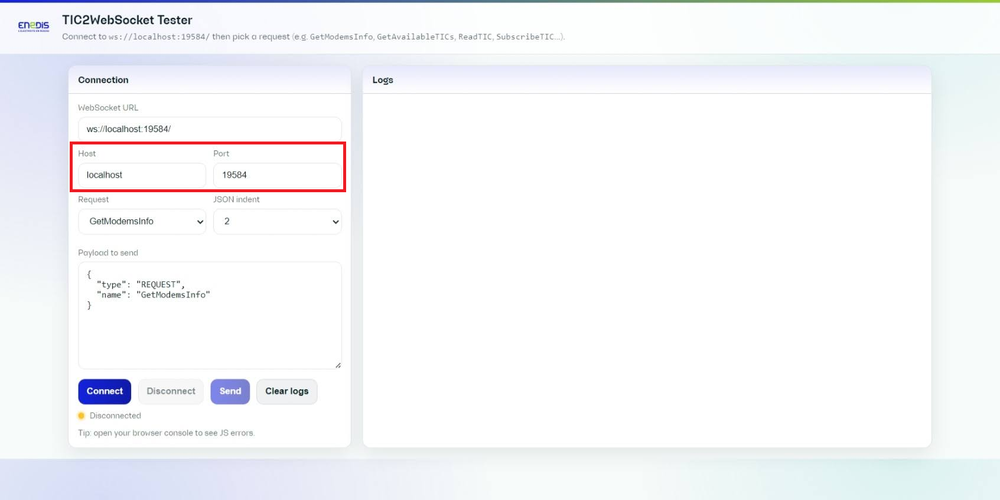
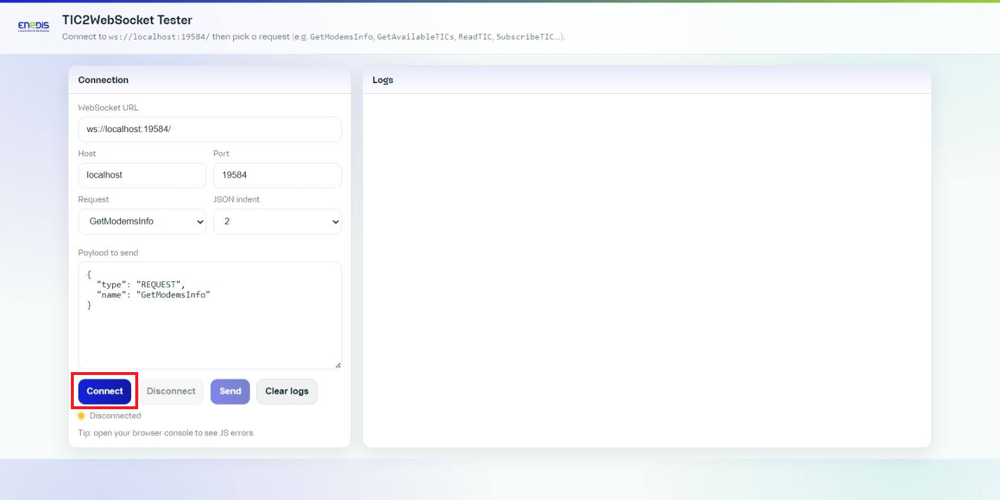
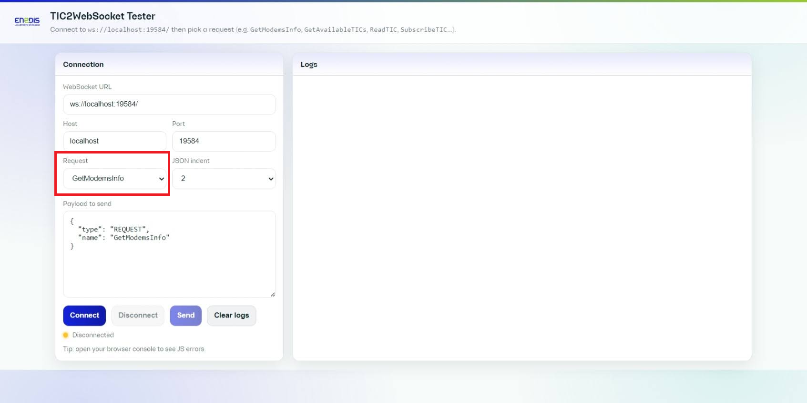
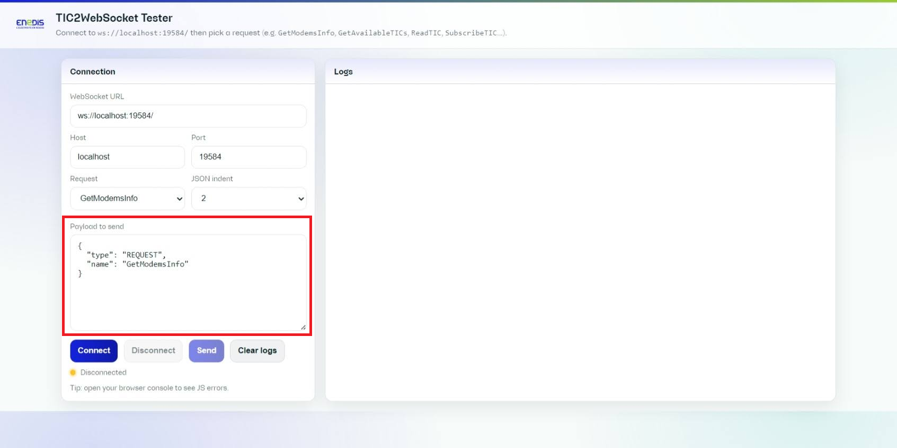
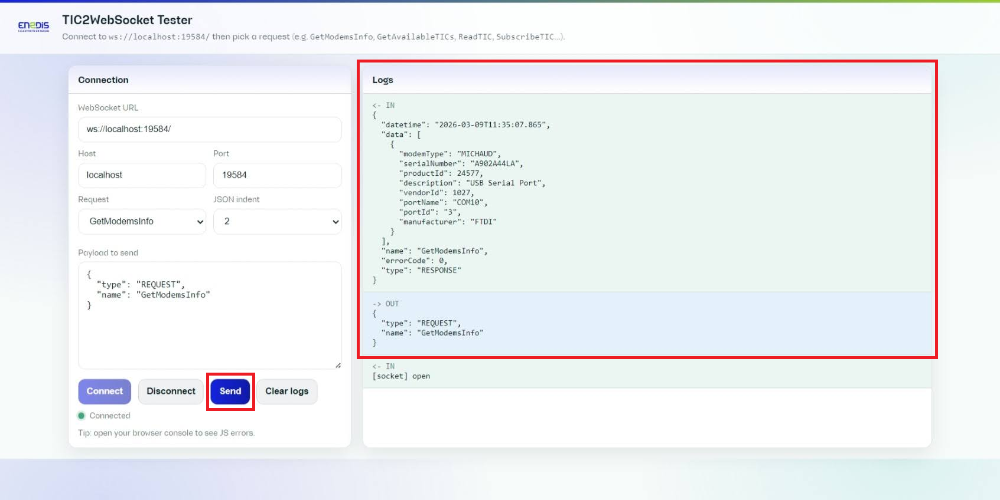
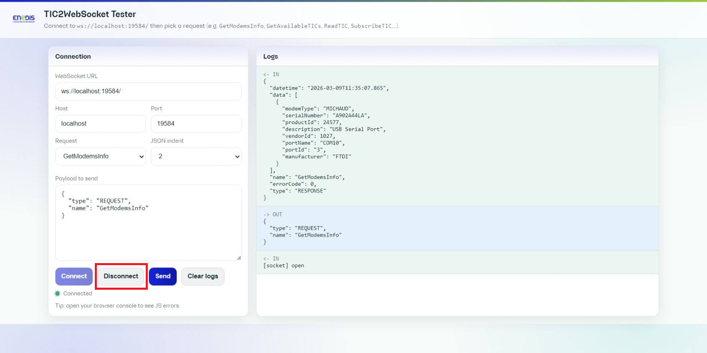

# WebSocket Tester

The project includes a ready-to-use WebSocket client interface: `ws-tester.html`.

This tester helps you quickly validate a TIC2WebSocket instance without having to develop a dedicated client.

## Role in the project

Use the tester to:

- verify that the WebSocket server is reachable,
- discover available TIC streams,
- generate valid JSON requests for the main API commands,
- inspect incoming responses/events in real time,
- reproduce integration issues while troubleshooting.

## Open the tester

Open `ws-tester.html` in your browser.

By default, it targets `ws://localhost:19584/`.

You can prefill the connection using query parameters:

- full URL: `?url=ws://localhost:19584/` (aliases: `wsUrl`, `ws`)
- host/port: `?host=localhost&port=19584` (host aliases: `address`, `addr`)

## Main usage flow

1. Check the default target URL or adjust the host/port if needed.

	

2. Click **Connect** to open the WebSocket session.

	

3. Choose a request preset from the dropdown list.

	

4. Check the generated JSON payload before sending it.

	

5. Click **Send** and watch the logs panel to inspect the request/response flow.

	

6. Click **Disconnect** when the test session is finished.

	

## Request presets and identifiers

Available presets:

- `GetModemsInfo`
- `GetAvailableTICs`
- `ReadTIC`
- `SubscribeTIC`
- `UnsubscribeTIC`

Identifier fields are optional except for `ReadTIC`, which requires an identifier.

Priority rule applied by the tester:

1. `serialNumber`
2. `portId`
3. `portName`

When a higher-priority identifier is active, lower-priority fields are automatically disabled.

For `SubscribeTIC` / `UnsubscribeTIC`:

- no identifier selected -> the request applies to all streams,
- one identifier selected -> the request targets that stream.

When receiving a `GetAvailableTICs` response, the tester automatically fills identifier fields using the first returned entry.

## Logs and diagnostics

- **OUT** lines: JSON sent by the client.
- **IN** lines: messages received from the server.
- **ERR** lines: client-side validation errors or socket errors.

`EVENT` messages are grouped by event name + identifier to keep logs readable in stream mode.

## Best practices

- Start with `GetAvailableTICs` before `ReadTIC`/`SubscribeTIC`.
- Keep JSON indentation at `2` for easier debugging.
- Use **Clear logs** before reproducing an issue.
- Keep useful request/response pairs when reporting a problem.
